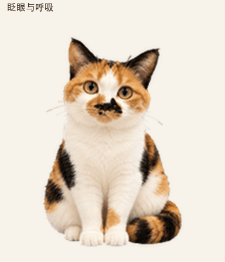

# 卓别林 · Calico Cat Pet Character

基于三花猫形象制作的 ChatGPT 自定义动态宠物。保留黄绿色眼睛、白胸口、白爪，以及鼻旁不对称的黑色花纹。



## 最终文件

- [透明宠物精灵图](outputs/zhuobielin-pet.png)：正式上传文件，PNG、RGBA、1536 × 2288。
- [九组动作检查表](outputs/action-list.png)：逐帧查看所有动作。
- [完整动画视频](outputs/zhuobielin-actions.mp4)。
- [十六个视线方向](outputs/directions.png)和[方向循环](outputs/look-loop.gif)。

棋盘动作仅保留猫和棋盘，周围背景透明；抓柱动作保留猫和麻绳柱。检查表中的方格及动画预览中的底色用于查看边缘，正式精灵图具有透明背景。

## 九组动作

| 顺序 | 动作 | 帧数 | Pets 动作槽 |
| --- | --- | ---: | --- |
| 1 | 眨眼与呼吸 | 6 | `idle` |
| 2 | 向右小跑 | 8 | `running-right` |
| 3 | 向左小跑 | 8 | `running-left` |
| 4 | 头朝下躺地，露肚皮撒娇 | 4 | `waving` |
| 5 | 起跳与落地 | 5 | `jumping` |
| 6 | 趴低盯视、扭屁股蓄力、突然猛扑 | 8 | `failed` |
| 7 | 肚子和后腿贴柱，抓麻绳柱往上扽 | 6 | `waiting` |
| 8 | 认真思考 | 6 | `running` |
| 9 | 坐五子棋盘，露后背看窗外，轻轻动耳朵 | 6 | `review` |

已删除原来的「等你回应」和「抬爪打招呼」。动作槽名称来自 Pets 固定格式；表中动作内容是本项目的自定义映射。

## 精灵图格式

采用 v2 的 8 列 × 11 行布局，每格 192 × 208。前九行有 57 个动作帧，后两行有 16 个顺时针视线方向，总计 73 个有效帧。

正式文件 SHA-256：

```text
60e94b9b6c8412e5f0b24a7d94feed228ed19de62041a7a7f34fee490ca562a6
```

可在支持自定义宠物的 ChatGPT Pets 工作流程中提交 `outputs/zhuobielin-pet.png`，完成验证后创建并选用。

## 项目目录

```text
pet.json               形象说明、动作映射和尺寸
outputs/                正式精灵图、动作表、GIF 和 MP4
source/strips/           生成的基础形象和动作源图
source/frames/           已选动作的透明帧及提取记录
source/look/             注册后的方向图及共享缩放参数
source/prompts/          形象和动作生成提示词
scripts/                组装、预览和动作表脚本
qa/                     最终结构、动画质量和方向检查记录
```

## 重建和预览

使用 Python 3，先安装依赖：

```bash
python3 -m pip install -r requirements.txt
```

组装脚本调用安装的 `work-pets:create-pet` 技能自带流水线。该技能的脚本不包含在本仓库；请将 `--skill-dir` 指向安装后包含 `SKILL.md` 与 `scripts/` 的目录：

```bash
python3 scripts/rebuild_pet.py --skill-dir /path/to/create-pet
python3 scripts/render_previews.py
python3 scripts/label_action_sheet.py --qa-dir work/rebuild/qa
```

重建文件写入 `work/rebuild/`，正式上传文件保留在 `outputs/`。预览脚本默认读取正式上传文件，可通过 `--atlas` 指定重建文件。中文字体默认使用 macOS 黑体；其他系统请用 `--font` 指定支持中文的字体文件。

新形象或视觉修正使用图像生成；脚本负责提取、排布、去蓝边、验证和编码。已选的源帧和方向注册参数保存在仓库中，方便重建当前版本。

## 验证记录

最终精灵图通过结构、透明背景、有效帧数、跳跃离地与落地、方向连续性及 Pets 预检。四个主要视线方向通过三位隔离评审；两个接近垂直的中间方向水平分量较轻，保留了人工复核说明。详细结果见 `qa/`。
